# 🖥️ Awesome Terminal Multiplexing & AI Workspaces

  

  
  
  
  
  
  

---

## 📖 Overview & SEO Summary

**Awesome Terminal Multiplexing & AI Workspaces** is a curated, production-grade index of next-generation **terminal multiplexers**, **AI agent coding workspaces**, **GPU-accelerated split terminals**, and **persistent PTY session managers**.

As autonomous coding agents (such as Claude Code, Codex CLI, OpenCode, and Gemini CLI) become core to developer workflows, modern terminal environments have evolved beyond traditional single-shell interfaces. Modern developers demand high-performance workspaces featuring vertical agent tabs, native split panes, socket-level automation APIs, persistent background daemon sessions, inline browser rendering, and real-time notification rings. This guide tracks both enterprise SaaS/cloud platforms and community-driven open-source projects.

---

## 📑 Table of Contents

- [📊 Sector Overview & Market Dynamics](#-sector-overview--market-dynamics)
- [☁️ SaaS & Hosted Platforms](#️-saas--hosted-platforms)
- [💻 Open-Source GitHub Projects](#-open-source-github-projects)
- [🧩 Advanced Extensions & Orchestrators](#-advanced-extensions--orchestrators)
- [🤝 How to Contribute](#-how-to-contribute)
- [💖 Support & Community](#-support--community)
- [📈 Star History](#-star-history)
- [📜 Disclaimer](#-disclaimer)

---

## 📊 Sector Overview & Market Dynamics

The global Cloud Development Environment (CDE) and developer workspace market is valued at approximately **$6.65 Billion in 2026** (growing toward **$25 Billion by 2035** at a ~14.2% CAGR), while the broader developer tooling market spans **$7.5B–$8.8B**. 

The sector displays a **moderately fragmented and bifurcated market structure**, where classical open-source terminal multiplexers (`tmux`, `screen`) maintain foundational protocol dominance, while high-growth enterprise entrants and AI-native cloud workspace platforms (`Coder`, `Warp`, `Gitpod`) compete fiercely in a winner-take-most dynamic for managed enterprise security, GPU compute orchestration, and agentic workspace governance.

---

## ☁️ SaaS & Hosted Platforms

The following table benchmarks commercial and managed terminal platforms, agentic workspaces, and cloud session providers. The table is ranked in **descending order by company scale** (estimated valuation / venture capital capitalization).

| Platform | Company Valuation / Scale | Starting Tier Pricing | Free Tier / Trial Limits | Description |
| :--- | :--- | :--- | :--- | :--- |
| **[Coder](https://coder.com)** | **$400M Valuation** (Series C, ~$175M total raised) | Custom enterprise quote (billed annually per user) | Free forever Community Edition (unlimited self-hosted workspaces & members; single org); 30-day full-feature enterprise trial | Enterprise self-hosted & cloud workspace platform provisioning standardized, SSH-accessible Linux environments for engineers & AI agents. |
| **[Warp Workspaces](https://warp.dev)** | **$200M Valuation** (Series B, $73M total raised) | $20/month per user ($18/mo billed annually) | Free forever tier (full GPU terminal features, Warp Agent CLI, SSH support; BYOK API keys for zero-markup AI execution) | Rust-based GPU-accelerated terminal offering cloud-synced Warp Drive workspaces, multi-agent orchestration, and team command sharing. |
| **[Gitpod](https://gitpod.io)** | **~$120M Valuation** (Series A, $41M total raised) | $9/user/month (or Pay-as-you-go at ~$0.36/hour) | Free forever tier (50 hours / 500 usage credits per month for personal & open-source projects) | Cloud-hosted, ephemeral developer workspaces accessible via browser or SSH/tmux with automated agent sandboxes. |
| **[Termius](https://termius.com)** | **$4M ARR** ($2.7M Seed raised; backed by YC) | $10/month per user (Pro plan, billed annually) | Free forever Starter plan (unlimited local vault SSH/SFTP client on 1 active device with AI autocomplete; 14-day Pro trial) | Cross-platform SSH and Mosh workspace client featuring multi-pane split sessions, encrypted vault sync, and team server orchestration. |
| **[cmux Pro / Cloud](https://cmux.com/)** | **Early-Stage / Bootstrapped** (Manaflow AI) | $50/month (or $40/mo billed annually at $480/yr) | Free forever open-source desktop client (local session history, agent socket API, and community Discord support) | Commercial companion to `cmux` providing persistent cloud Linux VMs, iOS mobile companion access, and managed cloud agent sandboxes. |
| **[Wave Terminal Cloud](https://waveterm.dev)** | **Seed / Early-Stage** (Open-Core) | Enterprise custom quote (Core app is free OSS) | Free forever open-source desktop app (100% free Apache-2.0 release for macOS, Linux, and Windows; zero feature paywalls) | AI-native open-core terminal workspace integrating inline web browsers, rich code viewers, and multi-model AI blocks across SSH hosts. |

---

## 💻 Open-Source GitHub Projects

The following table indexes leading open-source terminal multiplexers, agent-aware terminal workspaces, and GPU split terminals. Repositories are ranked in **descending order by GitHub Stargazer Count**.

| Project | Stars | Focus & Core Architecture | Key Features |
| :--- | :--- | :--- | :--- |
| **[Alacritty](https://github.com/alacritty/alacritty)** |  | GPU OpenGL Terminal | Minimalist, ultra-fast OpenGL terminal emulator written in Rust; the industry-standard lightweight rendering layer for multiplexed `tmux` and `Zellij` setups. |
| **[Ghostty](https://github.com/ghostty-org/ghostty)** |  | Zig GPU Workspace Terminal | Blazing-fast, native GPU-accelerated terminal emulator written in Zig featuring native split panes, multi-tabs, and embedded `libghostty` architecture. |
| **[tmux](https://github.com/tmux/tmux)** |  | C POSIX Terminal Multiplexer | The de-facto industry standard terminal multiplexer enabling persistent detached sessions, window groupings, pane splits, and robust CLI scripting hooks. |
| **[Hyper](https://github.com/vercel/hyper)** |  | Electron Web Terminal | Extensible, hackable terminal emulator built on web technologies (HTML/CSS/JS) with built-in split panes, tabs, and a massive plugin ecosystem. |
| **[Zellij](https://github.com/zellij-org/zellij)** |  | Rust Modern Multiplexer | Batteries-included terminal workspace and multiplexer featuring floating/stacked panes, declarative KDL layouts, WebAssembly plugin engine, and multiplayer pairing. |
| **[WezTerm](https://github.com/wez/wezterm)** |  | Rust GPU Multiplexer | GPU-accelerated cross-platform terminal emulator and multiplexer written in Rust with native SSH/TLS multiplexing domains, split panes, and Lua scripting. |
| **[cmux](https://github.com/manaflow-ai/cmux)** |  | Swift / Ghostty Native macOS | Ghostty-powered macOS terminal built for parallel AI coding agents with vertical tabs, real-time agent notification rings, split browser viewports, and Unix socket APIs. |
| **[Wave Terminal](https://github.com/wavetermdev/waveterm)** |  | AI-Native Terminal Workspace | Open-source terminal workspace combining traditional shell panes with persistent SSH sessions, inline Markdown/code viewers, and embedded web previews. |
| **[iTerm2](https://github.com/gnachman/iTerm2)** |  | macOS Objective-C Terminal | Feature-rich macOS terminal client offering deep native `tmux -CC` control mode integration, split panes, hotkey windows, triggers, and Python scripting APIs. |
| **[TPM (Tmux Plugin Manager)](https://github.com/tmux-plugins/tpm)** |  | Shell Plugin Manager | The standard plugin manager for `tmux`, automating installation, updates, and environment persistence for terminal multiplexer configurations. |
| **[tmuxinator](https://github.com/tmuxinator/tmuxinator)** |  | Ruby Session Orchestrator | Declarative YAML-based session manager for `tmux` to automate spawning multi-window/multi-pane project workspaces and background agent runners. |
| **[tmux-resurrect](https://github.com/tmux-plugins/tmux-resurrect)** |  | Session Persistence | Preserves and restores `tmux` environments across system reboots, sustaining panes, active layouts, working directories, and running processes. |
| **[ttyd](https://github.com/tsl0922/ttyd)** |  | C Web Terminal Server | High-performance command-line utility for sharing terminal sessions over the web via WebSockets with multi-client viewing and multiplexing. |
| **[Rio](https://github.com/raphamorim/rio)** |  | Rust WebGPU Terminal | Ultra-fast hardware-accelerated terminal emulator powered by WebGPU, supporting desktop platforms and in-browser WebAssembly execution with native splits. |
| **[TUIOS](https://github.com/Gaurav-Gosain/tuios)** |  | Go Terminal OS / Tiler | Terminal UI Operating System and tiling window manager written in Go featuring Vim modal navigation, persistent daemon sessions, and an AI coding agent Inbox. |
| **[Wetty](https://github.com/butlerx/wetty)** |  | Node.js Web Terminal | Web-based terminal emulator over HTTP and WebSockets using xterm.js, facilitating collaborative browser-accessible terminal multitasking. |
| **[tmuxp](https://github.com/tmux-python/tmuxp)** |  | Python Session Manager | Session manager built on `libtmux` that automates freeze/load configurations in YAML/JSON for complex terminal developer workspaces. |
| **[tmux-continuum](https://github.com/tmux-plugins/tmux-continuum)** |  | Automated Backup Engine | Continuous saving and automatic zero-touch restoration of `tmux` environments, snapshotting session state at 15-minute intervals. |
| **[Catppuccin for tmux](https://github.com/catppuccin/tmux)** |  | Workspace Theming & UX | Soothing pastel theme engine for `tmux` featuring custom status bars, agent indicator pills, active pane badges, and date/time widgets. |
| **[sesh](https://github.com/joshmedeski/sesh)** |  | Go Smart Session Switcher | Smart terminal session manager for `tmux` and `zoxide` designed for sub-second workspace switching and parallel agent dev loop orchestration. |
| **[Byobu](https://github.com/dustinkirkland/byobu)** |  | Multiplexer Wrapper | User-friendly configuration wrapper around `tmux` and GNU Screen providing hardware notification monitors, system status bars, and shortcut bindings. |
| **[Upterm](https://github.com/owenthereal/upterm)** |  | Go Terminal Sharing | Secure terminal sharing over SSH, facilitating seamless real-time pair programming, remote debugging, and multi-user terminal collaboration. |
| **[mtm](https://github.com/deadpixi/mtm)** |  | Minimalist C Multiplexer | Micro Terminal Multiplexer written in clean, minimal C with zero dependencies for ultra-lightweight split panes and resource-constrained environments. |
| **[abduco](https://github.com/martanne/abduco)** |  | C Session Manager | Clean Unix session management tool providing seamless process detach/attach capabilities independent of terminal emulation or tiling logic. |
| **[dvtm](https://github.com/martanne/dvtm)** |  | C Tiling Window Manager | Dynamic virtual terminal manager bringing dwm-style tiling window management and multi-pane multiplexing to console terminals. |
| **[limux](https://github.com/am-will/limux)** |  | Linux Workspace Manager | GPU-accelerated terminal workspace manager and multiplexer for Linux inspired by `cmux` and powered by Ghostty rendering engine. |
| **[cmux for Windows](https://github.com/mkurman/cmux-windows)** |  | Windows Native Multiplexer | Dark, keyboard-first terminal multiplexer and workspace manager for Windows inspired by `tmux` and `cmux`, built natively with WPF and ConPTY. |

---

## 🧩 Advanced Extensions & Orchestrators

- 🤖 **Parallel AI Agent Orchestrators**:
  - Spawning and monitoring parallel sub-agents across split panes via `using-cmux`, `claude-squad`, `agent-deck`, and `opencode-tmux`.
- ⚡ **Session Jumpers & Fuzzy Finders**:
  - Sub-second directory-to-multiplexer switching via `sesh`, `tmux-sessionizer`, `tms`, and `zoxide`.
- 🔄 **Autonomous Background Agents**:
  - Run continuous developer workflows using `tmux-resurrect`, `tmux-continuum`, and headless socket hooks (`cmux --socket`).

---

## 🤝 How to Contribute

Contributions are warmly welcomed! To contribute:

1. 🍴 **Fork the repository**.
2. ✍️ **Add or edit entries** in `README.md` following the existing tabular structure.
3. 📝 **Include all required fields**: Name, verified official link, pricing/tier details, and technical description.
4. 🚀 **Submit a Pull Request** with a descriptive summary of your changes.

---

## 💖 Support & Community

If you find this curated collection useful for your engineering and agent workflows:

- ⭐ **Star this repository** to support discovery!
- 🍴 **Fork and share** with colleagues and developer communities.
- 💬 Join the conversation on [Discord](https://discord.gg/jc4xtF58Ve).
- ☕ **Support the maintainer**: Buy a coffee or sponsor ongoing development via the [GitHub Sponsors Dashboard](https://github.com/sponsors/ishandutta2007).

Thank you to all contributors and open-source maintainers pushing terminal developer tooling forward! 🙌

---

## 📈 Star History

---

## 📜 Disclaimer

- This is an independent, community-curated collection intended for educational and developer productivity purposes.
- Multiplexers with socket APIs (`cmux`, `tmux`, `zellij`) or persistent background daemons allow external scripts and AI agents to send keystrokes and inspect screen buffers; ensure socket permissions remain strictly scoped to your local user credentials.
- When running autonomous AI coding agents across multiple terminal workspaces, review tool permissions and execution sandboxes to prevent unintended filesystem or network operations.

---

  <b>Built with ❤️ for terminal power users, systems engineers, and autonomous AI developers.</b>

